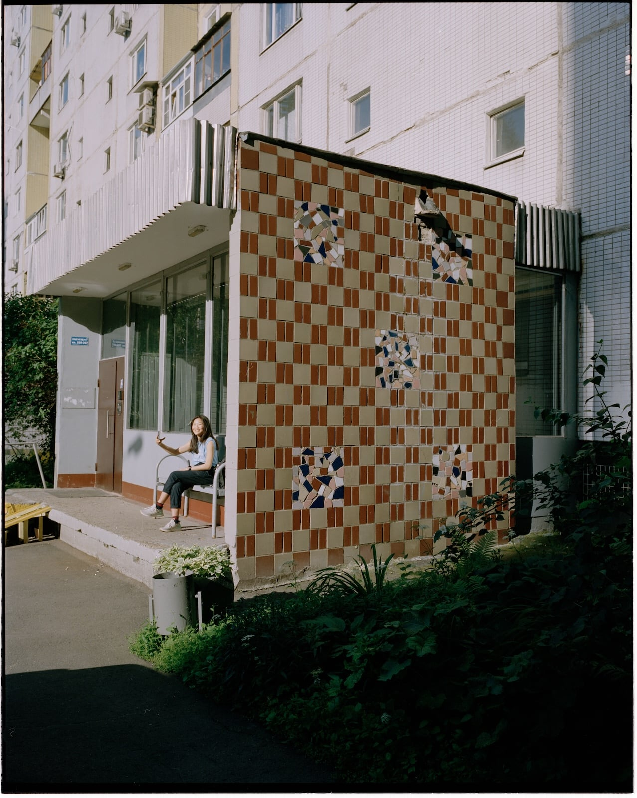

It's been a few years since I last published a coherent photographic project. The last one was “[Where the Story Begins](/projects/where-the-story-begins/)”, which attempted to tell the story of the sometimes chaotic early days of T.’s and my relationship and marriage. After we got married, we focused hard on building a life in London, and then we had kids.

I told myself that while the kids were little, I would focus on shooting, rather than editing work. Editing[^1] requires long stretches of focus time, which is just not available when you have small kids. So I've been accumulating photos, and I fell into what I think is poor photographic hygiene: I neglected my photo library to the point where it became an unmanageable mess.

Usually, when I import photos into my library, I do at least a first pass, reviewing all the images I have just imported, putting a 1-star rating on those that feel like they would deserve a second look later. Later, I look only at photos with a 1-star rating, and further narrow the selection down by rating some photos 2 stars, and so on, as much as needed. To give a sense of scale, my photo library currently contains 102k photos, out of which about 18,400 have a 1-star rating, and that narrows down to just 14 when we get to a 5-star rating.

I imported photos when I had time, sometimes hundreds or even thousands of photos at a time, after months of shooting. In a lot of cases, I would not have a chance to do even a first pass.

---

For a few years already, I had in the back of my mind a vaguely articulated “family” project, a follow-up to “Where the Story Begins”. In my mind, this was something that would take 10, 20, 30 years to really put together well: my ideal, for this kind of project, is [Lee Friedlander’s “Maria”](https://fraenkelgallery.com/exhibitions/lee-friedlander-maria), which is my favourite photobook on family, and a close contender for favourite photobook, period. I was also itching to do a project about the kids, about parenting, about T. as a mother… I wanted to do *something* with all these photos I had been accumulating: I liked some of them very much, and wanted more for them than 24 hours in my Instagram stories.

My messy photo library felt like an insurmountable obstacle. I felt like, to do any serious work, I first had to sort the library out: import all the film scans that had been sitting on a random external drive, in Dropbox, etc.; make sure those were in chronological order, and mapped to physical negatives; close up the gaps in ratings, which would mean reviewing thousands of photos. 

In short, I felt stuck.

---

It took two things to get me unstuck.

The first was completing another much smaller project, from a much smaller collection of a couple of hundred pictures.[^2] Working on this project reminded me how much I enjoyed making photo books, and also answered some questions I had for myself about editing and sequencing. For the first time, I tried using Figma for this, and it worked a treat. An infinite canvas on which to try out series and pairings works _really_ well, and it’s almost as good as laying out work prints on a gigantic table (and much more portable). Hat tip to [Craig Mod](https://craigmod.com) for sharing somewhere that he was editing this way.

The second thing that got me unstuck was, of all things, Claude. It helped me bring my Capture One library[^3] to a manageable state: film scans imported and catalogued, no more gaps in the ratings, etc. All in all, it processed about 20k photos, mostly loose film scans, plus the unrated backlog.

It accomplished this by doing what it does best: writing code. It explored my Capture One catalog (it’s SQLite), my Apple Photos library (also SQLite), my random folders with eight years’ worth of film scans, scattered across drives, cloud storage, my NAS… It organised everything into a SQLite database of its own, computed fingerprints and generated thumbnails for each image, which enabled it to identify pictures that had wildly different versions (scanned on different scanners, with different white balance, crops, etc.) and group them together. It used my Apple Photos favourites to close some of the rating gaps in Capture One.

It spent a long time preparing and asking me questions about my photos[^4], then it ran the process it had designed with my input overnight, and in the morning, I had a library that had everything I needed to start the actual creative work.

This, I am truly grateful for, but I also feel a sense of… embarrassment? Like, it was my own years of neglect that got my Capture One library into such a messy state. If I’d been more disciplined, I wouldn’t have needed to have an LLM agent (tech I feel, at best, [ambivalent about](/2026/ai)) come in and save my butt. However, as with many things these days, I’m trying to learn to give myself some grace: life with two small kids is challenging enough as it is.

---

So now, I am unstuck, and I can take the time to think about this project I want to do. I have many questions about the shape the project will take, and I have many photos that, hopefully, hold the answers. I’m sure this will take a long while, and I’m equally sure I’m going to enjoy the process. 

<figure>

<figcaption>T. in Strogino, Moscow, 2019 A recently imported 6×7 film scan</figcaption>
</figure>

[^1]: This is “editing” in the writing sense: the process of making a tight selection from a large number of photos, and pairing/grouping photos together, figuring out what gaps exist and what photos could fill them. The other activity that’s commonly referred to as “editing”, which is working on colours, cropping, etc., is also something that needs time, but I’m much less interested in that than I used to be, and so do less of it now.

[^2]: I’m hoping to be able to share this project before the end of the year.

[^3]: I feel like this system is ripe for reform, but currently, all of my photos are stored in a massive [Capture One](https://captureone.com) catalog. However, I also have a lot of photos in Apple Photos (with some overlap), and had loose files (mostly film scans) on random hard drives and cloud storage.

[^4]: One fascinating thing it did was, when trying to decide if two files were the same photo or not, it generated an HTML page containing about 200 pairs of photos it had low certainty about, with a checkbox next to each pair to mark it as “not the same photo”. At the bottom of the page was a self-updating text box containing a list of paths to all the file pairs that were not the same, for me to copy-paste into the agent.
